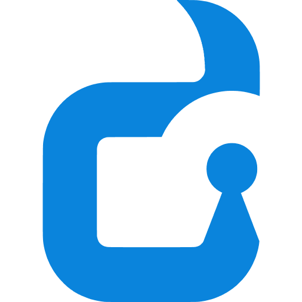

<div align="center">
  
  <h1>LACI DOSCOM</h1>
  <p><b>Layanan Administrasi & Catatan Informasi Surat</b></p>
  <p>Platform persuratan digital, pelacakan alur dokumen Kanban, dan generator surat otomatis berbasis Google Drive untuk komunitas dan organisasi.</p>

  <p>
    <a href="LICENSE"></a>
    <a href="https://doscom.org"></a>
    <a href="backend/README.md"></a>
    <a href="frontend/README.md"></a>
    <a href="docker-compose.yml"></a>
  </p>
</div>

---

## Daftar Isi
- [Tentang Proyek](#tentang-proyek)
- [Fitur Utama](#fitur-utama)
- [Matriks Hak Akses](#matriks-hak-akses)
- [Arsitektur Sistem](#arsitektur-sistem)
- [Panduan Memulai (Quickstart)](#panduan-memulai-quickstart)
  - [1. Mode Produksi (Zero-Configuration)](#1-mode-produksi-zero-configuration)
  - [2. Mode Pengembangan (Hot-Reload)](#2-mode-pengembangan-hot-reload)
  - [3. Opsi Native (Tanpa Docker)](#3-opsi-native-tanpa-docker)
- [Pusat Dokumentasi](#pusat-dokumentasi)
- [Kontribusi](#kontribusi)
- [Lisensi](#lisensi)

---

## Tentang Proyek

**LACI** adalah sistem manajemen administrasi persuratan internal yang dikembangkan secara terbuka oleh **Dinus Open Source Community (DOSCOM)**. Platform ini mengatasi fragmentasi birokrasi organisasi mahasiswa dengan menyatukan pembuatan draf dokumen otomatis, pengawasan progres penandatanganan surat multi-tahap, hingga arsip fisik digital dalam satu dasbor terpusat.

LACI dirancang dengan prinsip **Lean Software Engineering**: dependensi minimal, performa responsif di peramban seluler, dan kemudahan deployment tanpa konfigurasi manual yang rumit (*zero setup*).

---

## Fitur Utama

- **Papan Pelacakan Kanban 8 Tahap:** Pemantauan status surat secara *real-time* mulai dari status `Standby`, `Cetak`, rangkaian perizinan dan tanda tangan (Sekretaris, Ketua Pelaksana, Ketua Umum, Pembina, Dosen/Fakultas), hingga `Selesai` lengkap dengan rekam jejak audit (*audit trail*).
- **Generator Surat Otomatis (Serverless Google Apps Script):** Menghubungkan template dokumen di Google Drive dengan sistem. Variabel dinamis `{{placeholder}}` digantikan otomatis menjadi berkas Google Docs dan PDF siap cetak tanpa beban server lokal.
- **Autentikasi Mandiri Zero-Knowledge:** Pendaftaran pengurus baru tanpa *hardcoded password*. Setiap pengguna mengaktifkan akun dan membuat kata sandi mandiri melalui tautan verifikasi bertoken.
- **Suksesi Kepemimpinan Otomatis (Genesis & Transfer Ketum):** Pembuatan akun perdana Ketua Umum melalui seeder otomatis saat instalasi pertama, serta mekanisme peralihan jabatan resmi yang divalidasi dengan proteksi kata sandi.
- **Impor Massal Multi-Sumber:** Pendaftaran puluhan pengurus secara instan melalui unggah berkas CSV lokal atau sinkronisasi langsung dengan tautan Google Spreadsheet publik.
- **Arsip Digital & Bukti Fisik:** Pengunggahan scan dokumen fisik atau jepretan kamera langsung dari peramban ponsel setelah proses surat selesai ditandatangani.

---

## Matriks Hak Akses

| Hak Akses / Aksi | Ketua Umum (Superadmin) | Sekretaris (Admin Operasional) | Humas (Operator Alur) | Divisi / BPH Lain |
| :--- | :---: | :---: | :---: | :---: |
| **Papan Kanban & Riwayat Surat** | Baca & Perbarui | Penuh (CRUD + Cetak) | Update Tahap Surat | Baca Sesuai Program |
| **Generator Google Docs** | Akses Penuh | Akses Penuh | - | - |
| **Konfigurasi Webhook GAS** | Akses Penuh | Akses Penuh | - | - |
| **Manajemen Pengguna (User)** | Akses Penuh | Akses Penuh | - | - |
| **Impor CSV / Spreadsheet** | Ya | Ya | - | - |
| **Transfer Jabatan Ketum** | Ya (Hanya Ketum Aktif) | - | - | - |
| **Unggah Bukti Fisik Surat** | Kapan Saja | Kapan Saja | Saat Status 'Selesai' | Saat Status 'Selesai' |

---

## Arsitektur Sistem

LACI dibangun menggunakan pola arsitektur berlapis yang lugas (*Pragmatic Lean Layered Architecture*):

```text
[ Peramban Pengguna / Mobile Client ]
                 │ (Port 80)
                 ▼
[ Nginx Reverse Proxy (Frontend Container) ]
  ├── /          ──> SPA Vue 3 + Tailwind CSS v4 (Aset Statis)
  ├── /uploads/  ──> Direktori Bukti Arsip Fisik Backend
  └── /api/      ──> Reverse Proxy ke Backend Go (Port 8080)
                       │
  ┌────────────────────┴─────────────────────┐
  ▼                                          ▼
[ Handlers (Gin Delivery) ]            [ Google Apps Script Webhook ]
  │ (Otentikasi, Parsing Request)        │ (Generasi GDocs & PDF)
  ▼                                          ▼
[ Services (Business Rules) ]          [ Google Drive Folder ]
  │ (Logika Surat, Suksesi, JWT)
  ▼
[ Repositories (Data Access) ]
  │ (Query Bersih GORM)
  ▼
[ PostgreSQL 15 Database ]
```

---

## Panduan Memulai (Quickstart)

### 1. Mode Produksi (Zero-Configuration)

Dalam mode produksi, PM atau DevOps dapat langsung menjalankan sistem tanpa konfigurasi awal. Nginx dan Backend otomatis menyesuaikan dengan domain atau IP host server yang digunakan:

```bash
# Clone repositori
git clone https://github.com/Chqrety/laci.git
cd laci

# Jalankan kontainer produksi (Nginx port 80 & Backend rilis)
docker compose up -d --build

# Periksa token aktivasi akun Ketua Umum perdana
docker compose logs backend
```

Buka peramban pada alamat server Anda (`http://<ip-atau-domain>/activate?token=<token>`) untuk mengaktifkan akun pertama kali.

---

### 2. Mode Pengembangan (Hot-Reload)

Gunakan mode ini untuk pengembangan aktif. Frontend (Vite HMR) dan Backend (Golang Air) akan me-reload perubahan kode secara otomatis:

```bash
# Salin konfigurasi dev lokal
cp .env.dev.example .env

# Jalankan lingkungan development
docker compose -f docker-compose.dev.yml up --build
```

- **Frontend Web:** `http://localhost:5173`
- **Backend API:** `http://localhost:8080`
- **PostgreSQL:** `localhost:5432`

---

### 3. Opsi Native (Tanpa Docker)

Jika ingin menjalankan service langsung pada mesin lokal:

```bash
# 1. Menjalankan Backend (Golang)
cd backend
go run .

# 2. Menjalankan Frontend (Vue 3)
cd frontend
npm install
npm run dev
```

---

## Pusat Dokumentasi

Untuk rincian teknis mendalam, silakan merujuk pada dokumentasi berikut:

- [**CONTRIBUTING.md**](CONTRIBUTING.md) — Panduan alur kontribusi, standar branching `dev`, dan konvensi commit.
- [**CODE_OF_CONDUCT.md**](CODE_OF_CONDUCT.md) — Kode etik komunitas DOSCOM (Contributor Covenant v2.1).
- [**SECURITY.md**](SECURITY.md) — Tata cara pelaporan kerentanan keamanan secara tertutup.
- [**CONTEXT.md**](docs/CONTEXT.md) — Arsitektur teknis lengkap untuk referensi LLM dan pengembang baru.
- [**Master PRD v2**](docs/PRD.md) — Dokumen spesifikasi kebutuhan produk, alur bisnis, dan skema database.
- [**Panduan Template Surat**](docs/PANDUAN_SEKRE_TEMPLATE_SURAT.md) — Panduan Sekretaris membuat template Google Docs.
- [**Backend README**](backend/README.md) — Struktur layered architecture, rute API, dan modul backend.
- [**Frontend README**](frontend/README.md) — Panduan desain Atomic UI, Tailwind CSS, dan state management.

---

## Kontribusi

Kontribusi dari seluruh anggota DOSCOM maupun komunitas sumber terbuka sangat diharapkan!
1. Buka branch baru yang ditargetkan ke basis branch `dev`.
2. Pastikan kode lulus verifikasi tipe frontend (`npm run typecheck`) dan kompilasi backend (`go vet ./...`).
3. Ajukan *Pull Request* dengan melengkapi format yang tersedia di [.github/PULL_REQUEST_TEMPLATE.md](.github/PULL_REQUEST_TEMPLATE.md).

---

## Lisensi

Proyek ini didistribusikan di bawah lisensi terbuka [MIT License](LICENSE).  
Hak Cipta (c) 2026 **Dinus Open Source Community (DOSCOM)**.
